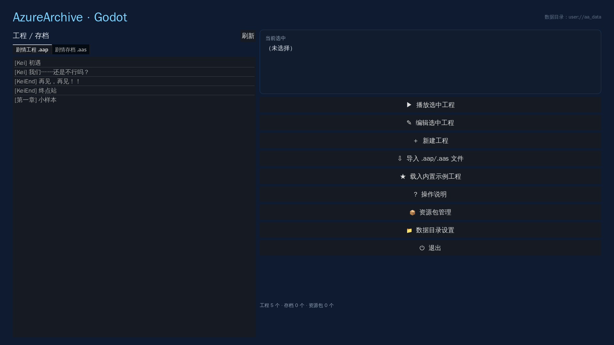
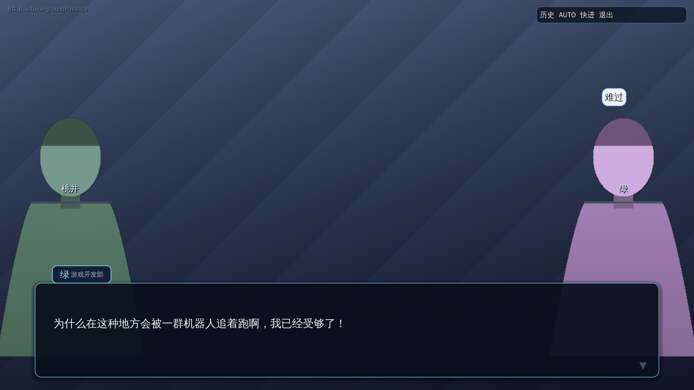
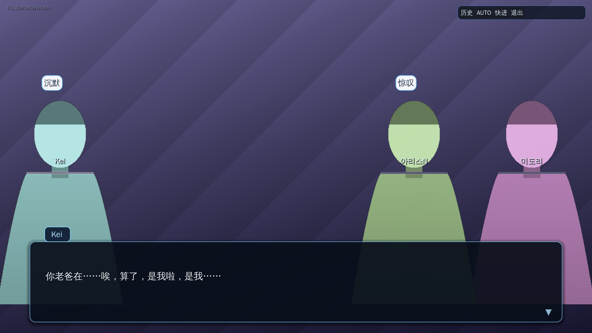
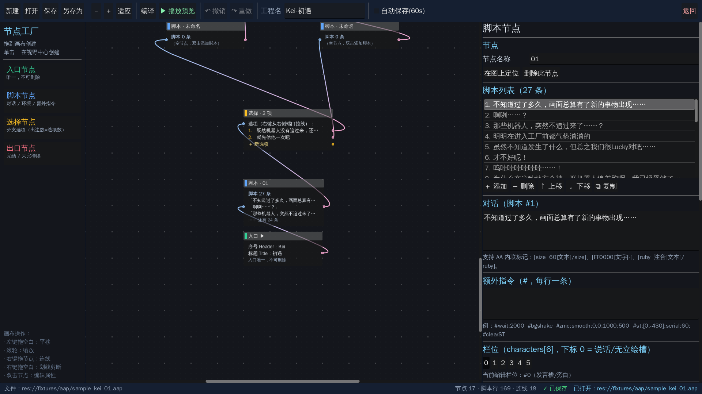

# AzureArchive · Godot 复刻

用 **Godot 4.7（纯 GDScript）** 复刻 [AzureArchive](https://aadoc.foxxlight.top/)（AA，面向《蔚蓝档案》的非官方剧情编辑器 + 剧情播放器），
并完整支持 AA 的**项目文件格式（`.aap`）**与**资源包 / 自定义资源格式**。

> 本项目是粉丝向技术复刻（非官方），与 Foxxlight（狐光体）、Yostar、Nexon 无任何关联。
> AA 的文本、图片、音效、音乐及素材版权归各自作者所有；本项目不附带任何官方素材。

## 效果预览

| 目录界面 | 剧情播放器（无资源包时用占位素材） |
|---|---|
|  |  |

| 选项演出 | 节点式编辑器 |
|---|---|
|  |  |

> 截图为 headless + Xvfb 实际渲染（1920×1080，`scripts/shot_*.gd`）。没有 AA 官方资源包，
> 所以背景/立绘使用程序化占位素材；安装 aa_pack 或自定义资源后会显示真实素材。

## 当前状态

- **测试**：`bash scripts/test.sh` → **11 用例全绿 / 1452 断言 / 0 失败**（含真实 `.aap` 样本 round-trip、
  播放器全片播放、编辑器新建→连线→保存→重载、目录界面用户路径集成）。
- **格式规范**：`docs/spec/` 5 篇（`.aap` / 指令 / 资源包 / 枚举 / 索引），基于 36 个真实 AA 工程统计反推。
- **可在真实数据上跑**：把数据目录指向 AA 的 `data/` 即可读取已有工程与 `overrides/` 自定义资源。

## 目前能做什么

| 能力 | 状态 |
|---|---|
| 读取 AA 工程文件 `.aap`（Newtonsoft JSON，含 `$type`/字段顺序/GUID/连线/画布坐标） | ✅ |
| 写回 AA 兼容 `.aap`（字段顺序、`$type`、选择节点 16 槽、X/Y 坐标） | ✅ |
| 节点图编辑器：入口 / 脚本 / 选择 / 出口节点、连线、检查器、保存/另存、编译预览 | ✅ |
| 剧情播放器：背景/过渡、BGM/SE/语音、5 立绘槽、表情/走位/进出场/气泡/动作、对话框打字机、选项、Ending/未完待续 | ✅ |
| `#额外指令`（`#wait` `#bgshake` `#zmc` `#st/#stm/#clearST` `#hidemenu/#showmenu` `#N;m/#N;hide/#N;al|ar|a|dl|dr|d` `#nextepisode` …） | ✅ |
| 对话框内联标记 `[size=…]` `[RRGGBBAA]…[-]` `[ruby=…]` | ✅ |
| AA 数据目录布局（`projects/ saves/ overrides/ assets/`）与自定义资源 `manifest.json` | ✅ |
| 全局 `overrides/` + 本地 `<工程名>/` 自定义资源覆盖优先级（pack < overrides < 本地） | ✅ |
| `aa_pack` 开放资源包格式（`catalog.json` + 素材目录）与安装/管理 | ✅ |
| AA 官方资源包（Unity Addressables）转换工具（Python + UnityPy）→ `aa_pack` | ✅（见 `tools/`） |
| Spine 骨骼动画运行时 | ⚠️ 静态帧/atlas 兜底 + PNG 立绘完整支持；骨骼动画接口预留 |
| AA 编译产物 `.aas`（FlatBuffers 二进制） | ❌ 暂不解析（无公开 schema），直接播放 `.aap` |

## 已构建的版本（GitHub Releases）

> 仓库：<https://github.com/XLYZ-P/AzureArchive-Godot>（private）
> 发布页：<https://github.com/XLYZ-P/AzureArchive-Godot/releases/tag/v1.0.0>
> Release 附件：`AzureArchiveGodot-windows.exe`、`AzureArchive-Godot-android.apk`、`AzureArchive-Godot-source.zip`


| 平台 | 产物 | 说明 |
|---|---|---|
| Windows | `AzureArchiveGodot.exe`（118MB） | 单文件自包含，双击运行；数据目录 `%APPDATA%\Godot\app_userdata\AzureArchive Godot\aa_data` |
| Android | `AzureArchive-Godot.apk`（39MB，arm64-v8a） | 自签安装包，应用名「AzureArchive Godot」，minSdk 24 / targetSdk 36 |
| Linux arm64（验证用） | `AzureArchiveGodot-linux-arm64` + `.pck` | 用于验证打包链路（本机 Xvfb 实跑通过） |

产物位于 `/sdcard/Download/DSH-Go/AA-Godot-builds/`；构建方法与原理见 [docs/BUILD.md](docs/BUILD.md)。

> 本机的 Godot 导出器（`--export`/`--editor`）在 Android proot 环境会崩溃，所以构建走
> 「引擎内置 `PCKPacker` 打包 + 官方导出模板手工装配」路线：Windows 是模板 exe 追加自包含 PCK 页脚，
> Android 是官方模板 APK 原地改包名/应用名/图标后注入 `assets/assets.sparsepck` 并用 `apksigner` 自签。

## 快速开始

1. 安装 Godot **4.7**（标准版即可，不需要 .NET/mono）。
2. 用 Godot 打开本目录的 `project.godot`，按 F5 运行（或导出到 Windows/Android）。
3. 首次启动数据目录是 `user://aa_data/`（=`~/.local/share/godot/app_userdata/AzureArchive Godot/aa_data`）。
   在「数据目录设置」里可以指向 AA 的真实数据目录：
   - Windows：`%APPDATA%\..\LocalLow\foxxlight\AzureArchive\data`
   - Android：`/storage/emulated/0/Android/data/com.foxxlight.AzureArchive/files/data`
   - iOS：文件 App 内 `AzureArchive/data`
4. 把 `.aap` 工程（连同同名自定义资源文件夹）放进 `projects/`，或点「导入 .aap」。
5. 「下载官方资源包」不可用时：用 `tools/extract_aa_pack.py` 把 AA 资源包（`WIN_xxx.zip`/`AND_xxx.zip`）转成 `aa_pack`，
   在「资源包管理 → 导入资源包」安装；也可以完全依赖 AA 的 `overrides/` 与工程本地自定义资源。

## 命令行（headless / CI）

```bash
# 全量测试（自动生成 class_name 缓存）
bash scripts/test.sh

# 冒烟运行主场景
scripts/godot.sh --quit-after 5

# 离屏截图（需要 xvfb + mesa；本机已装）
xvfb-run -a -s "-screen 0 1920x1080x24" \
  /opt/godot/Godot_v4.7.2-stable_linux.arm64 --path . --rendering-driver opengl3 \
  --script scripts/screenshot.gd -- --scene=res://scenes/main/Main.tscn --out=/tmp/main.png
```

## 目录结构

```
addons/aa_core/        # .aap 数据模型 / 读写 / 指令解析 / 编译（GDScript）
addons/aa_resources/   # 数据目录 / manifest / 覆盖优先级 / aa_pack / 资源解析
addons/aa_player/      # 剧情播放器运行时
addons/aa_editor/      # 节点式剧情编辑器
scenes/main/           # 目录界面（工程/存档、数据目录、资源包管理）
scenes/player/         # 播放器场景
scenes/editor/         # 编辑器场景
assets/                # 内置 UI 素材与中文字体
docs/DESIGN.md         # 架构契约（API/格式/分工）
docs/spec/             # AA 格式规范（逆向整理，中文）
fixtures/              # 真实 .aap 样本、合成工程、合成资源包
tools/                 # Python 工具（AA 资源包 → aa_pack 转换等）
tests/                 # headless 测试套件
scripts/               # 开发脚本（Godot 封装、class cache 生成、截图）
```

## 文档

- [docs/DESIGN.md](docs/DESIGN.md)：架构与模块契约
- [docs/spec/](docs/spec/)：`.aap` / 资源包 / 指令 / 枚举格式规范
- [docs/USAGE.md](docs/USAGE.md)：使用说明（编辑器操作、播放器键位、资源包导入）

## 开发约定

- 本机（Android proot）headless 环境**不能跑** `godot --import/--editor`（会崩溃）；素材一律运行时加载（`AaRawLoader`）。
- `class_name` 全局解析依赖 `.godot/global_script_class_cache.cfg`，新增类后运行 `python3 scripts/gen_class_cache.py`。
- 详细约定见 [docs/DESIGN.md](docs/DESIGN.md) §10/§11。
